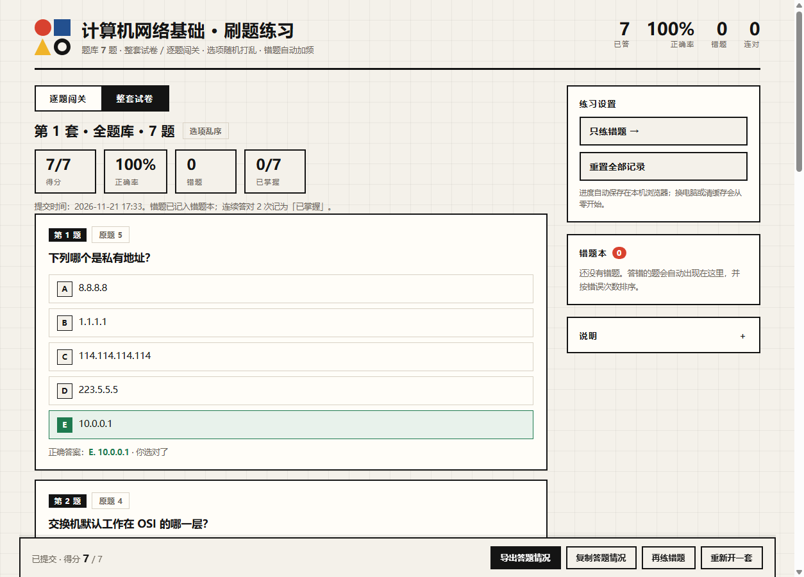
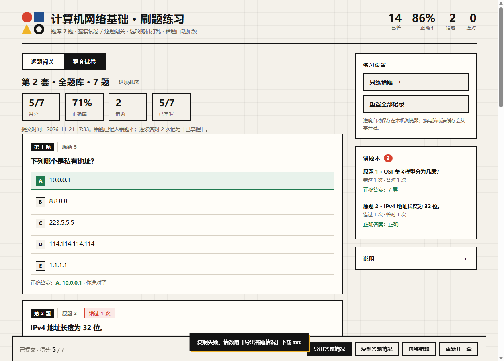
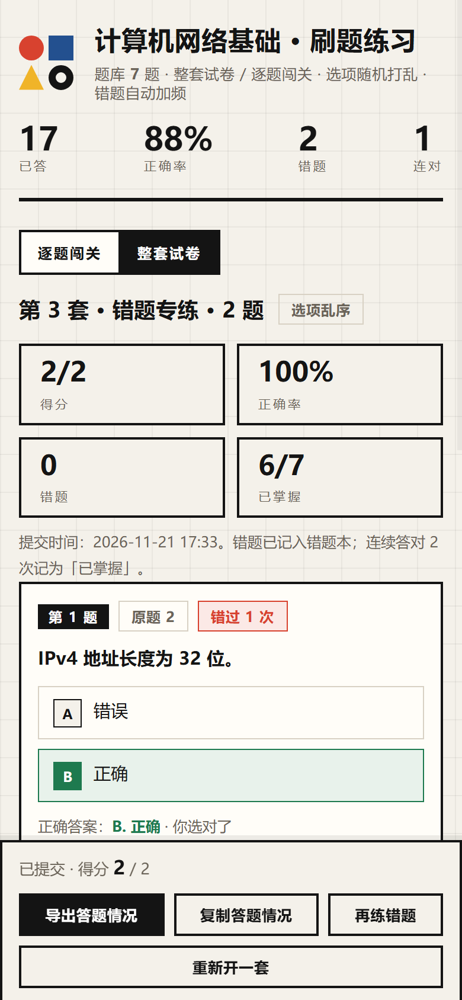

# quiz-bank-page

**把课程题库变成一份单文件、离线可用的刷题网页。**

输入一份题库（docx / xlsx / PDF / 截图 / 文本），输出一个 `.html`：双击就能在任何电脑、平板或手机上刷题，不联网、不用装环境、不用起服务器。

它原本是一个 DeepSeek Harness（DSH）技能：把提取、校验、构建、自检四步固化下来，换课程只换题库，页面不用重做。


## 特性

- **两种模式**：整套试卷（一页排完全部题，提交后给分、逐题标出正确答案）和逐题闯关（一次一题，答错立刻给答案，1–3 题后重现）。
- **选项每题乱序**：每次渲染重新洗牌，并保证不与题库原顺序相同；判分按「展示位置 → 原选项下标」映射，不靠字母。
- **错题自动加频**：答错次数越多，之后出现越频繁；连续答对 2 次记为「已掌握」。
- **可导出的答题情况**：整套提交后可导出 / 复制 txt（得分、错题明细、逐题作答、错题 ID），发给 AI 就能安排下一轮。
- **全离线单文件**：无外链、无 fetch、无依赖，`file://` 直接打开；记录存在浏览器 `localStorage`。
- **支持 2–8 个选项**：判断题用 `["正确", "错误"]` 两个选项即可。
- 键盘作答（A–H / 1–8，回车下一题），移动端单栏适配。

## 快速开始

### 直接试示例

仓库自带一份 7 题的演示页（计算机网络基础），双击 `examples/demo.html` 即可。如果仓库开启了 GitHub Pages，也可以在线打开 `examples/demo.html`。

### 用现成题库构建

```bash
python scripts/build.py questions.json "计算机网络基础_刷题练习.html"
```

只需要 Python 3（无第三方依赖）。生成的文件可以随意改名、拷走、发给别人。

### 装成 DSH 技能

把整个仓库目录放到 DSH 的 skills 目录下，命名 `quiz-bank-page`（例如 `~/.dsh/skills/quiz-bank-page`，Windows 视 `DSH_HOME` 而定）。之后直接说「把这份题库做成刷题网页」即可触发。

### 自检（可选，需要本机 Chrome）

```bash
node scripts/test_quiz.js "计算机网络基础_刷题练习.html" questions.json 自检输出目录
```

会用无头 Chrome 跑完整流程：题量、选项乱序、整套全对、导出 txt、错题卷、逐题键盘、刷新持久化、移动端溢出、控制台错误，并留下 4 张截图。输出 `RESULT: ALL PASS` 才算通过。

## 题库格式

```json
{
  "meta": {
    "title": "计算机网络基础",
    "key": "net-basics",
    "source": "你的 docx 题库（120 题）",
    "fileBase": "计算机网络基础"
  },
  "questions": [
    {"id": 1, "q": "OSI 参考模型分为几层？", "opts": ["5 层", "7 层", "4 层"], "ans": 1},
    {"id": 2, "q": "IPv4 地址长度为 32 位。", "opts": ["正确", "错误"], "ans": 0}
  ]
}
```

| 字段 | 说明 |
| --- | --- |
| `meta.title` | 页面标题、导出 txt 标题 |
| `meta.key` | `localStorage` 键后缀，**不同课程必须不同**，否则记录会串 |
| `meta.source` | 页面「说明」里的题库来源 |
| `meta.fileBase` | 导出文件名前缀 |
| `meta.ocrNote` | 可选，`false` 时隐藏页面里的 OCR 修正说明 |
| `questions[].id` | 原题号或顺序号；页面显示为「原题 NN」 |
| `questions[].q` | 题干 |
| `questions[].opts` | 选项原文，按原顺序放，**不要在这里打乱** |
| `questions[].ans` | 正确项下标，从 **0** 开始 |

构建脚本会校验：题干非空且不重复、选项 2–8 个且不重复、`ans` 合法、id 唯一；并打印题目数、选项数分布和答案分布，方便和原文件对数。

## 从题库到 JSON

`references/parse-guide.md` 里有 docx / xlsx / PDF / 图片题库的提取方法与常见坑：

- docx 常见「上一题 D 选项和下一题题干粘在同一段」，需要在题号前补换行；
- 答案可能写在题干末尾、括号里，或卷末答案表；
- 扫描件 OCR 必须人工核对选项字母和答案字母；
- 答案拿不准的题**不要猜**，列出来问用户，宁可少一题也不编。

提取完先跑构建，再肉眼抽 3 题对照原文，然后跑自检。

## 目录结构

```
quiz-bank-page/
├── SKILL.md                  # DSH 技能说明（完整工作流）
├── assets/template.html      # 页面模板：CSS + 刷题引擎 + 占位符
├── scripts/build.py          # 校验 questions.json 并注入模板
├── scripts/test_quiz.js      # 无头 Chrome 端到端自检
├── references/parse-guide.md # 题库提取与清洗指南
├── examples/sample-questions.json
├── examples/demo.html        # 由示例题库构建好的演示页
└── docs/screenshots/         # 桌面 / 移动端 / 提交结果截图
```

## 截图

| 整套试卷 | 提交结果 |
| --- | --- |
|  |  |

| 错题明细 | 移动端 |
| --- | --- |
|  |  |

## 限制

- **只支持单选**：一题多个正确项的题型不支持。请拆成多道单选，或排除这些题——不要只保留一个正确项当单选，那会教错。
- 无后端、无账号：记录只存在当前浏览器的 `localStorage`，换电脑或清缓存会重置（先导出 txt 可留档）。
- 页面字体使用系统字体，不同系统观感略有差异。

## License

MIT
